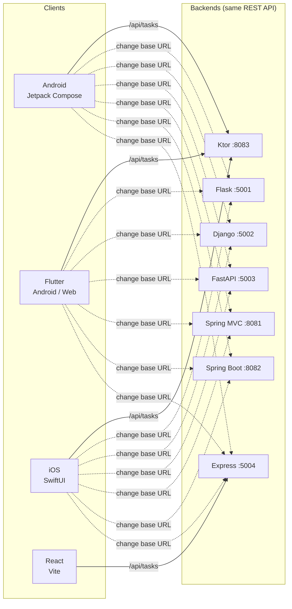

# MultiApp: one app, many stacks

**The same Task Manager app, built 10 times, in Python, Java, Kotlin, JavaScript, Dart and Swift.**

Every version does the same four things: **create, list, mark done and delete** tasks. Every backend
exposes the **same REST API**, so any client (React, Android, Flutter, iOS) works with any backend.
To switch backends, change one base URL.


[](LICENSE)

---

## Why this repo exists

Comparing frameworks is easiest when everything except the framework stays the same. Here, every
implementation has the same features, the same API and the same data shape. So when you put two
folders side by side, the differences you see come from the stack itself:

- How **Flask** and **Django** structure the same CRUD app
- What **Spring Boot** auto-configures, compared with plain **Spring MVC** wired by hand
- How **Jetpack Compose**, **Flutter** and **SwiftUI** build the same screen
- How a **React** client talks to an **Express** API backed by **MongoDB**

## How the pieces connect



The mobile clients use the **Ktor** server by default, which makes Ktor plus Android a complete
Kotlin stack. The Python and Java backends also include their own web UI.

## The stacks

| Folder | Stack | Kind | Port | Storage |
|---|---|---|---|---|
| [`python/flask-app`](python/flask-app) | Flask + Jinja templates | Full stack | 5001 | SQLite (`sqlite3`) |
| [`python/django-app`](python/django-app) | Django + Django templates | Full stack | 5002 | SQLite (ORM) |
| [`python/fastapi-app`](python/fastapi-app) | FastAPI + SQLModel + vanilla JS page | Full stack | 5003 | SQLite (SQLModel) |
| [`java/spring-app`](java/spring-app) | Spring MVC 6 (no Boot) + Thymeleaf, WAR | Full stack | 8081 | In-memory |
| [`java/springboot-app`](java/springboot-app) | Spring Boot 3 + JPA + Thymeleaf | Full stack | 8082 | H2 (file) |
| [`kotlin/ktor-server`](kotlin/ktor-server) | Ktor | Backend | 8083 | In-memory |
| [`kotlin/android-app`](kotlin/android-app) | Android, Jetpack Compose + Retrofit | Mobile client | – | any backend |
| [`flutter/task_app`](flutter/task_app) | Flutter (Dart) + `http` | Cross-platform client | – | any backend |
| [`swift/TaskApp`](swift/TaskApp) | SwiftUI (iOS) | Mobile client | – | any backend |
| [`mern/`](mern) | MongoDB + Express + React (Vite) + Node | Full stack | 5004 / 5173 | MongoDB |

## The shared API contract

Every backend implements exactly this API:

| Method | Path | Body | Response |
|---|---|---|---|
| `GET` | `/api/tasks` | – | `200` `[Task]` |
| `POST` | `/api/tasks` | `{"title": "Buy milk"}` | `201` `Task` |
| `PUT` | `/api/tasks/{id}` | `{"title"?: "...", "done"?: true}` | `200` `Task` / `404` |
| `DELETE` | `/api/tasks/{id}` | – | `204` / `404` |

```json
Task = { "id": 1, "title": "Buy milk", "done": false }
```

- A missing or blank `title` on create returns `400 {"error": "title is required"}`.
- Every backend sends CORS headers for `/api/*`, so browser clients such as React and Flutter web
  can call any of them.

Try any running backend from a terminal:

```bash
curl http://localhost:8083/api/tasks
curl -X POST http://localhost:8083/api/tasks -H "Content-Type: application/json" -d '{"title":"Buy milk"}'
```

## Quick start

Clone the repo:

```bash
git clone <this-repo-url>
cd MultiApp
```

Then start one backend and one client. The fastest pair is **Ktor + Android** or **Ktor + Flutter web**.

### Prerequisites

Install only what the stacks you want to run need.

| You want to run | You need |
|---|---|
| Python apps | Python 3.10+ |
| Spring / Spring Boot | JDK 17+ (Maven is downloaded by the included `mvnw`) |
| Ktor | JDK 17+ (Gradle is downloaded by the included `gradlew`) |
| Android app | Android Studio (bundles the SDK and a JDK) |
| Flutter app | Flutter SDK 3.22+ (Dart 3.4+) |
| MERN | Node.js 18+ and MongoDB (local, or Docker) |
| iOS app | macOS with Xcode 15+ and [XcodeGen](https://github.com/yonaskolb/XcodeGen) |

### Backends

<details>
<summary><b>Ktor</b> on port 8083 (the default backend for the mobile apps)</summary>

```bash
cd kotlin/ktor-server
./gradlew run          # Windows: .\gradlew.bat run
```
</details>

<details>
<summary><b>Flask</b> on port 5001</summary>

```bash
cd python/flask-app
python -m venv .venv
source .venv/bin/activate        # Windows: .venv\Scripts\activate
pip install -r requirements.txt
python app.py
```
</details>

<details>
<summary><b>Django</b> on port 5002</summary>

```bash
cd python/django-app
python -m venv .venv
source .venv/bin/activate        # Windows: .venv\Scripts\activate
pip install -r requirements.txt
python manage.py migrate
python manage.py runserver 5002
```
</details>

<details>
<summary><b>FastAPI</b> on port 5003</summary>

```bash
cd python/fastapi-app
python -m venv .venv
source .venv/bin/activate        # Windows: .venv\Scripts\activate
pip install -r requirements.txt
python main.py                   # or: uvicorn main:app --port 5003 --reload
```
</details>

<details>
<summary><b>Spring MVC</b> (no Boot) on port 8081</summary>

```bash
cd java/spring-app
./mvnw jetty:run                 # Windows: .\mvnw.cmd jetty:run
```
</details>

<details>
<summary><b>Spring Boot</b> on port 8082</summary>

```bash
cd java/springboot-app
./mvnw spring-boot:run           # Windows: .\mvnw.cmd spring-boot:run
```

H2 console: http://localhost:8082/h2-console (JDBC URL `jdbc:h2:file:./data/tasks`, user `sa`).
</details>

<details>
<summary><b>MERN</b>: Express API on 5004, React UI on 5173</summary>

```bash
# MongoDB (skip if it is already installed locally)
docker run -d -p 27017:27017 --name mongo mongo:7

# API
cd mern/server
cp .env.example .env
npm install
npm run dev

# React client (in a second terminal)
cd mern/client
npm install
npm run dev
```
</details>

### Clients

<details>
<summary><b>Android</b> (Jetpack Compose)</summary>

1. Start the Ktor backend.
2. In Android Studio, choose **File ▸ Open**, select `kotlin/android-app`, and wait for Gradle sync to finish.
3. Pick an emulator and click **Run ▶**.

The base URL is set in `app/build.gradle.kts` (`API_BASE_URL`).
</details>

<details>
<summary><b>Flutter</b> (Android, web)</summary>

Only `lib/` and `pubspec.yaml` are checked in. The platform folders are generated:

```bash
cd flutter/task_app
flutter create .                 # one-time: generates android/, ios/, web/ ...
flutter pub get
flutter run -d chrome            # or pick an Android emulator
```

For Android, add `android:usesCleartextTraffic="true"` to the `<application>` tag in
`android/app/src/main/AndroidManifest.xml` so the app can call plain `http://` backends.
To change the backend, edit `_port` in `lib/task_api.dart`.
</details>

<details>
<summary><b>iOS</b> (SwiftUI, macOS only)</summary>

```bash
cd swift/TaskApp
xcodegen generate                # creates TaskApp.xcodeproj from project.yml
open TaskApp.xcodeproj
```
</details>

## Pointing a client at another backend

Change the base URL's port to any backend from the table above:

| Running on | Base URL |
|---|---|
| Android emulator | `http://10.0.2.2:<port>` (the emulator's alias for your computer) |
| iOS simulator, desktop, web | `http://localhost:<port>` |
| Real phone on the same Wi-Fi | `http://<your-computer-LAN-IP>:<port>` |

## Project structure

```
MultiApp/
├── python/
│   ├── flask-app/        Flask + Jinja + SQLite
│   ├── django-app/       Django + ORM + SQLite
│   └── fastapi-app/      FastAPI + SQLModel + SQLite
├── java/
│   ├── spring-app/       Spring MVC 6, hand-wired, WAR
│   └── springboot-app/   Spring Boot 3 + JPA + H2
├── kotlin/
│   ├── ktor-server/      Ktor REST backend
│   └── android-app/      Jetpack Compose + Retrofit client
├── mern/
│   ├── server/           Express + Mongoose API
│   └── client/           React (Vite) UI
├── flutter/
│   └── task_app/         Flutter client (lib/ + pubspec.yaml)
└── swift/
    └── TaskApp/          SwiftUI client (XcodeGen project.yml)
```

Each folder has its own `README.md` with more details.

## Author

**Venkata Sai Vardhan Thimmisetty** · [@sai2408](https://github.com/sai2408)

## License

Released under the [MIT License](LICENSE).
